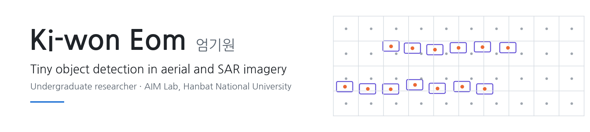
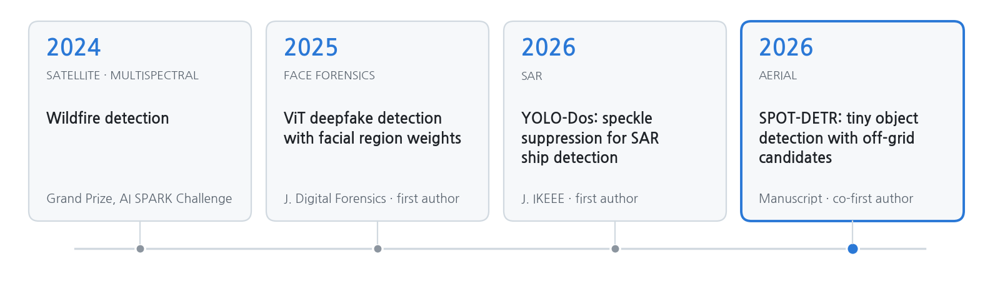
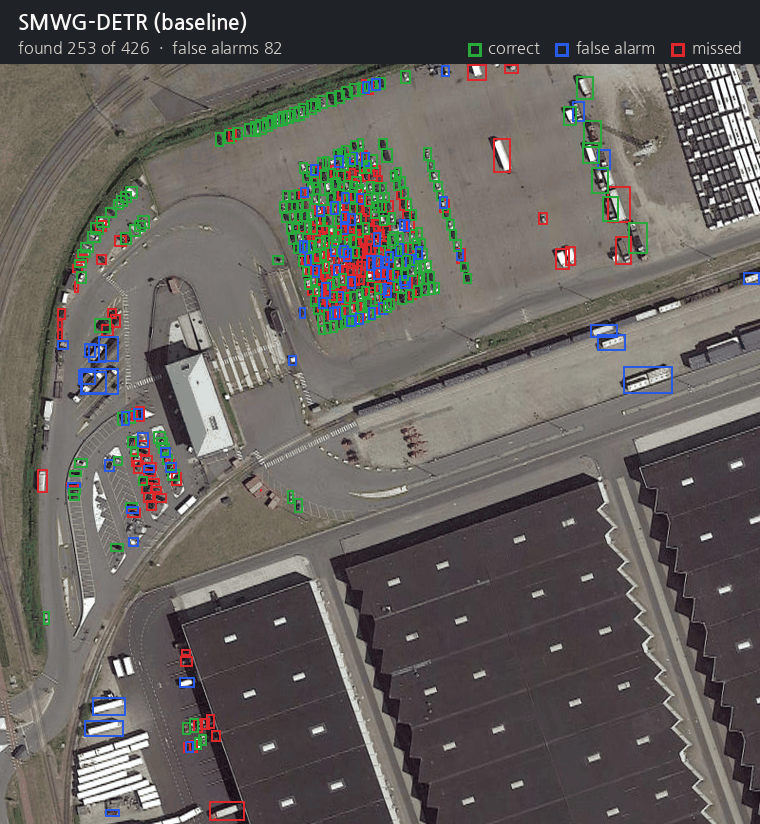
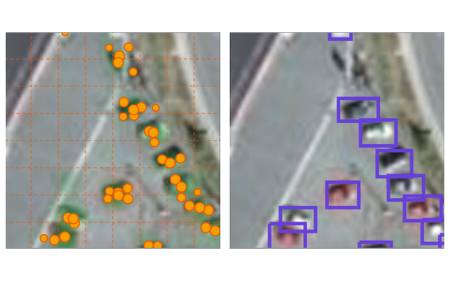
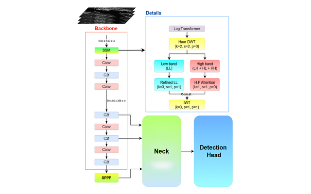

<picture>
  <source media="(prefers-color-scheme: dark)" srcset="assets/banner-dark.png">
  
</picture>

  
  
  
  
  

<b>English</b> · <a href="README_KO.md">한국어</a>

Hi there 👋 I'm Ki-won, an undergrad in Computer Engineering at **Hanbat National University** and an undergraduate researcher in the **AIM Lab** (advised by Prof. Haneol Jang) since Feb 2024.

I work on **finding objects that are only a few pixels wide** in aerial and SAR images. Most of my time goes into figuring out *why* a detector misses them (feature resolution? where the candidates start? sensor noise?) and then building the model around that answer.

I'm open to **research internships**, **graduate programs** and **AI research engineer roles**. Feel free to reach out!

  
  
  
  
  

## News

- **[Oct 2026]** Finished the SPOT-DETR manuscript. Submitting soon!
- **[Oct 2026]** Placed 6th of 138 teams in the 2026 National Park Satellite Monitoring AI Challenge (coastal debris detection).
- **[2026]** LG Aimers 9th cohort: 29th of 1,090 teams in the online hackathon, then 15th in the offline final (Phase 3).
- **[Mar 2026]** YOLO-Dos is out in the Journal of IKEEE.
- **[2025]** Our ViT deepfake detection paper is out in the Journal of Digital Forensics.
- **[2025]** 16th of 271 teams at the 2025 SW-Centered University Digital Competition (AI track).
- **[2024]** Won the Grand Prize at the 6th AI SPARK Challenge (wildfire detection from satellite imagery).
- **[Feb 2024]** Joined the AIM Lab.

## Research so far

<picture>
  <source media="(prefers-color-scheme: dark)" srcset="assets/research-line-en-dark.png">
  
</picture>

## Featured: SPOT-DETR

Same AI-TOD-v2 test image, baseline vs. ours. Green is correct, blue is a false alarm, red is missed. SPOT-DETR finds 349 of the 426 objects here; the baseline finds 253.

Tiny objects end up as one or two cells on the feature map, and DETR-style detectors start their queries from cell centers, so a 2-pixel offset is enough to miss one. SPOT-DETR keeps a stride-4 path, refines it with a Laplacian gate (SGS), and lets queries start from **off-grid "atoms"** instead of cell centers (ATOM). It reaches **37.6 AP on AI-TOD** and **33.3 AP on AI-TOD-v2**, the best among the detectors we retrained under the same setting.

[project page](https://github.com/EomOrigin/HBNU-SWUNIV_2026_eomkiwon/blob/main/SPOT-DETR_EN.md) · [manuscript](https://github.com/EomOrigin/HBNU-SWUNIV_2026_eomkiwon/blob/main/paper/SPOT_DETR_manuscript_20261022.pdf)

## Publications

† equal contribution

<table>
<tr>
<td width="30%" valign="top"></td>
<td valign="top">
<b>SPOT-DETR: Tiny object detection in aerial images using high-resolution feature refinement and off-grid candidate memory</b> 
<b>Ki-won Eom</b>†, Cheoneum Park†, Eunkyung Kim, Haneol Jang 
<i>Manuscript in preparation</i>, 2026 
<a href="https://github.com/EomOrigin/HBNU-SWUNIV_2026_eomkiwon/blob/main/SPOT-DETR_EN.md">project page</a> / <a href="https://github.com/EomOrigin/HBNU-SWUNIV_2026_eomkiwon/blob/main/paper/SPOT_DETR_manuscript_20261022.pdf">manuscript</a>
</td>
</tr>
<tr>
<td width="30%" valign="top"></td>
<td valign="top">
<b>YOLO-Dos: Improving YOLO-based SAR object detection performance via a speckle suppression module</b> 
<b>Ki-won Eom</b>, Eunkyung Kim, Haneol Jang 
<i>Journal of IKEEE</i>, 30(1):171–181, 2026 · KCI 
<a href="https://doi.org/10.7471/ikeee.2026.30.1.171">DOI</a> / <a href="https://www.kci.go.kr/kciportal/ci/sereArticleSearch/ciSereArtiView.kci?sereArticleSearchBean.artiId=ART003322680">KCI</a>
</td>
</tr>
<tr>
<td width="30%" valign="top"></td>
<td valign="top">
<b>ViT-based deepfake detection via regional emphasis weights on eyes, nose, and mouth</b> 
<b>Ki-won Eom</b>, Dong-Su Kim, Tae-Woo Oh, Haneol Jang 
<i>Journal of Digital Forensics</i>, 19(4):116–131, 2025 · KCI 
<a href="https://doi.org/10.22798/KDFS.2025.19.4.116">DOI</a> / <a href="https://www.kci.go.kr/kciportal/ci/sereArticleSearch/ciSereArtiView.kci?sereArticleSearchBean.artiId=ART003243484">KCI</a>
</td>
</tr>
</table>

<!--
Conference papers (add when ready)
- Authors. "Title." Conference, Year.
-->

## Projects

- **Illegal livestock barn detection** · *in progress, 2026*
- **Cloud segmentation in satellite imagery** · team lead, 2025 · thick cloud, thin cloud and shadow masks; 2nd place in a course Kaggle challenge (0.8555)
- **Face anti-spoofing** · team lead, 2025 · live vs. spoofed faces at 98.33% accuracy
- **Face-recognition smart door lock** · team lead, 2024 · Raspberry Pi 4, OpenCV, SQLite, MQTT

## Honors & Competitions

| Result | Competition | Year |
|---|---|:---:|
| **Grand Prize** | 6th AI SPARK Challenge (Korea R&D Special Zones) · wildfire detection from multispectral satellite imagery | 2024 |
| **29th / 1,090** (top 3%) → **15th** in the offline final | LG Aimers 9th cohort hackathon · pitch control success prediction | 2026 |
| **6th / 138** (top 5%) | 2026 National Park Satellite Monitoring AI Challenge · Track 4: coastal debris detection and size estimation | 2026 |
| **16th / 271** (top 6%) | 2025 SW-Centered University Digital Competition · AI track | 2025 |
| **85th / 985** (top 9%) | 3rd Wind Power Generation Forecasting AI Competition (BARAM 2026) | 2026 |
| **28th / 219** (top 13%) | SW-Centered University Digital Competition · SW meets generative AI, AI track | 2024 |
| **2nd** | Cloud segmentation Kaggle challenge · Hanbat National University AI course | 2025 |

## Experience & Education

- **AIM Lab, Hanbat National University** · undergraduate researcher, advised by Prof. Haneol Jang · Feb 2024 – present
- **Hanbat National University** · B.S. in Computer Engineering · Mar 2023 – present

## Skills

**Languages** Python · C · Java 
**DL / CV** PyTorch · MMDetection · Ultralytics YOLO · timm · OpenCV · MediaPipe 
**Infra** Linux multi-GPU servers · Docker · Git · Weights & Biases

<!--
Add when available: Talks & posters / Teaching / Reviewing / Open source
-->
