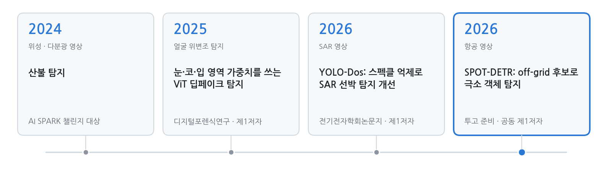

<picture>
  <source media="(prefers-color-scheme: dark)" srcset="assets/banner-dark.png">
  
</picture>

  
  
  
  
  

<a href="README.md">English</a> · <b>한국어</b>

안녕하세요 👋 국립한밭대학교 컴퓨터공학과 엄기원입니다. 2024년 2월부터 장한얼 교수님 지도 아래 **AIM Lab**에서 학부연구생으로 연구하고 있습니다.

항공·SAR 영상에서 **몇 픽셀짜리 객체를 찾는 문제**를 주로 다룹니다. 검출기가 그 객체를 *왜* 놓치는지(특징 해상도 때문인지, 후보가 출발하는 위치 때문인지, 센서 잡음 때문인지)를 먼저 따져 보고, 그 답에 맞춰 모델을 만드는 편입니다.

연구 인턴, 대학원 진학, AI 연구 엔지니어 자리에 관심이 많습니다. 편하게 연락 주세요!

  
  
  
  
  

## 소식

- **[2026.10]** SPOT-DETR 원고를 마무리했습니다. 곧 투고합니다!
- **[2026.10]** 2026 국립공원 위성 모니터링 AI 챌린지(해안 쓰레기 탐지)에서 138팀 중 6위를 했습니다.
- **[2026]** LG Aimers 9기 온라인 해커톤에서 1,090팀 중 29위로 오프라인 본선(Phase 3)에 올라 최종 15위를 했습니다.
- **[2026.03]** YOLO-Dos가 전기전자학회논문지에 실렸습니다.
- **[2025]** ViT 딥페이크 탐지 논문이 디지털포렌식연구에 실렸습니다.
- **[2025]** 2025 SW중심대학 디지털 경진대회 AI부문에서 271팀 중 16위를 했습니다.
- **[2024]** 제6회 연구개발특구 AI SPARK 챌린지(위성 영상 산불 탐지)에서 대상을 받았습니다.
- **[2024.02]** AIM Lab에 합류했습니다.

## 지금까지의 연구

<picture>
  <source media="(prefers-color-scheme: dark)" srcset="assets/research-line-ko-dark.png">
  
</picture>

## 대표 연구: SPOT-DETR

같은 AI-TOD-v2 test 영상에서 기준 모델과 SPOT-DETR을 번갈아 보여 줍니다. 초록은 맞힌 것, 파랑은 오탐, 빨강은 놓친 것입니다. 이 장면에서 SPOT-DETR은 426개 중 349개를, 기준 모델은 253개를 찾았습니다.

극소 객체는 특징 맵에서 한두 칸에 불과하고, DETR 계열 검출기는 셀 중심에서 쿼리를 출발시키기 때문에 2픽셀만 어긋나도 놓치기 쉽습니다. SPOT-DETR은 stride 4 경로를 남겨 라플라시안 게이트(SGS)로 다듬고, 셀 중심 대신 **off-grid atom**에서 쿼리를 출발시킵니다(ATOM). 같은 조건으로 다시 학습한 비교 모델 가운데 **AI-TOD 37.6 AP**, **AI-TOD-v2 33.3 AP**로 가장 높았습니다.

[프로젝트 페이지](https://github.com/EomOrigin/HBNU-SWUNIV_2026_eomkiwon/blob/main/SPOT-DETR.md) · [원고](https://github.com/EomOrigin/HBNU-SWUNIV_2026_eomkiwon/blob/main/paper/SPOT_DETR_manuscript_20261022.pdf)

## 논문

† 공동 제1저자

<table>
<tr>
<td width="30%" valign="top"></td>
<td valign="top">
<b>SPOT-DETR: Tiny object detection in aerial images using high-resolution feature refinement and off-grid candidate memory</b> 
<b>엄기원</b>†, 박천음†, 김은경, 장한얼 
<i>투고 준비 중</i>, 2026 
<a href="https://github.com/EomOrigin/HBNU-SWUNIV_2026_eomkiwon/blob/main/SPOT-DETR.md">프로젝트 페이지</a> / <a href="https://github.com/EomOrigin/HBNU-SWUNIV_2026_eomkiwon/blob/main/paper/SPOT_DETR_manuscript_20261022.pdf">원고</a>
</td>
</tr>
<tr>
<td width="30%" valign="top"></td>
<td valign="top">
<b>YOLO-Dos: 스펙클 억제 모듈을 통한 YOLO 기반 SAR 객체 탐지 성능 개선</b> 
<b>엄기원</b>, 김은경, 장한얼 
<i>전기전자학회논문지</i>, 30(1), 171–181, 2026 · KCI 등재 
<a href="https://doi.org/10.7471/ikeee.2026.30.1.171">DOI</a> / <a href="https://www.kci.go.kr/kciportal/ci/sereArticleSearch/ciSereArtiView.kci?sereArticleSearchBean.artiId=ART003322680">KCI</a>
</td>
</tr>
<tr>
<td width="30%" valign="top"></td>
<td valign="top">
<b>눈·코·입 영역 강조 가중치를 활용한 ViT 기반 딥페이크 탐지 기법 연구</b> 
<b>엄기원</b>, 김동수, 오태우, 장한얼 
<i>디지털포렌식연구</i>, 19(4), 116–131, 2025 · KCI 등재 
<a href="https://doi.org/10.22798/KDFS.2025.19.4.116">DOI</a> / <a href="https://www.kci.go.kr/kciportal/ci/sereArticleSearch/ciSereArtiView.kci?sereArticleSearchBean.artiId=ART003243484">KCI</a>
</td>
</tr>
</table>

<!--
학술대회 논문 (정보 받으면 추가)
- 저자. "제목." 학술대회명, 연도.
-->

## 프로젝트

- **불법 축사 탐지 모델 개발** · *진행 중, 2026*
- **위성 영상 구름 분할** · 팀장, 2025 · 두꺼운 구름·얇은 구름·그림자 분할, 교과 Kaggle 챌린지 2위(0.8555)
- **얼굴 위조 판별** · 팀장, 2025 · 실제 얼굴과 위조 얼굴을 정확도 98.33%로 구분
- **얼굴 인식 스마트 도어락** · 팀장, 2024 · Raspberry Pi 4, OpenCV, SQLite, MQTT

## 수상·대회

| 결과 | 대회 | 연도 |
|---|---|:---:|
| **대상** | 제6회 연구개발특구 AI SPARK 챌린지 · 위성 다분광 영상 기반 산불 탐지 | 2024 |
| **29위 / 1,090팀**(상위 3%) → 오프라인 본선 **15위** | LG Aimers 9기 해커톤 · 투구 제구 성공 확률 예측 | 2026 |
| **6위 / 138팀**(상위 5%) | 2026 국립공원 위성 모니터링 AI 챌린지 · 주제 4: 해안 쓰레기 탐지 및 규모 추정 | 2026 |
| **16위 / 271팀**(상위 6%) | 2025 SW중심대학 디지털 경진대회 · AI부문 | 2025 |
| **85위 / 985팀**(상위 9%) | 제3회 풍력발전량 예측 AI 경진대회 (BARAM 2026) | 2026 |
| **28위 / 219팀**(상위 13%) | SW중심대학 디지털 경진대회 · SW와 생성 AI의 만남, AI부문 | 2024 |
| **2위** | 위성 영상 구름 분할 Kaggle 챌린지 · 국립한밭대학교 AI 교과 | 2025 |

## 경력·학력

- **AIM Lab, 국립한밭대학교** · 학부연구생, 지도교수 장한얼 · 2024.02 – 현재
- **국립한밭대학교** · 컴퓨터공학과 학사과정 · 2023.03 – 현재

## 기술

**언어** Python · C · Java 
**딥러닝·비전** PyTorch · MMDetection · Ultralytics YOLO · timm · OpenCV · MediaPipe 
**실험 환경** Linux 다중 GPU 서버 · Docker · Git · Weights & Biases

<!--
생기면 추가: 발표·포스터 / 조교 / 리뷰어 / 공개 코드
-->
